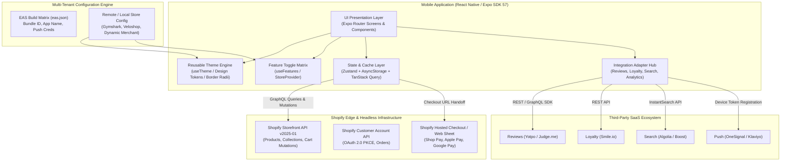

# Architecture and Integration Plan: Shopify Store to Mobile App Platform

This document outlines the engineering architecture, integration strategy, third-party ecosystem evaluation, and deployment model for converting Shopify stores into branded, high-performance Android and iOS mobile applications using a unified React Native platform.

---

## 1. High-Level Architecture Diagram



---

## 2. Core Architecture Breakdown

### 2.1 Shared Codebase with Store-Specific Branding and Configuration
To eliminate the burden of managing multiple repositories, the platform implements a **White-Label Design System** powered by configuration tokens.

1. **Design Tokens (`BrandingConfig`)**:
   - Color palettes: `primaryColor`, `secondaryColor`, `backgroundColor`, `textColor`, `cardColor`.
   - Structural tokens: `borderRadius`, `spacingScale`, `fontFamily`.
2. **Feature Flags (`FeatureFlags`)**:
   - Enables or disables third-party modules dynamically: `reviews`, `loyalty`, `wishlist`, `recentlyViewed`, `search`, `notifications`.
3. **Runtime Injection (`StoreProvider`)**:
   - Screens and atomic components consume themes strictly through hooks (`useTheme()`, `useStore()`, `useFeatures()`).
   - Zero hardcoded colors, dimensions, or merchant strings exist in screen components. Switching a configuration instantly reskins the app (e.g., Gymshark's monochrome athletic look vs. Veloshop's vibrant blue/orange aesthetic).

### 2.2 Merchant Onboarding, Authorization, and Credential Security
- **Storefront API Tokens**: Public read-only access tokens (`X-Shopify-Storefront-Access-Token`) are scoped specifically to storefront operations (reading products, creating customer carts). These are injected per merchant build via environment variables (`EXPO_PUBLIC_STOREFRONT_TOKEN`).
- **Admin API & Sensitive Operations**: Shopify Admin API tokens or merchant webhook secrets **never** reside on mobile clients. Any sensitive mutation (e.g. gift card balance verification, custom ERP sync) routes through a lightweight Backend-for-Frontend (BFF) proxy.
- **Secure Local Storage**: User session tokens and Customer Access Tokens are encrypted on-device using `expo-secure-store` (iOS Keychain and Android Keystore).
- **Merchant Onboarding Flow**:
  1. Merchant authorizes the white-label custom app via Shopify Partner Dashboard or Admin App setup.
  2. The merchant's myshopify domain, Storefront token, and brand assets (logo, hex codes, typography) are registered in the platform registry.
  3. CI/CD initiates an automated EAS build targeting the merchant's dedicated app bundle ID.

### 2.3 Shopify APIs for Products, Cart, Accounts, and Checkout
- **Catalog Operations**: Uses Storefront API v2025-01 GraphQL queries (`products`, `productByHandle`, `collectionByHandle`) with cursor pagination, normalized money types, and variant inventory checks.
- **Cart Session Lifecycle**:
  - `cartCreate`: Initializes a server-backed Shopify cart session returning a persistent `cartId` and encrypted `checkoutUrl`.
  - `cartLinesAdd` / `cartLinesUpdate` / `cartLinesRemove`: Executes edge inventory reservation and price calculations.
- **Customer Accounts**: Uses the modern **Shopify Customer Account API** (OAuth 2.0 PKCE flow) rather than legacy multipass, enabling seamless native-to-web single sign-on.
- **Production Checkout Flow**:
  - The cart state is synchronized via GraphQL.
  - When the customer taps "Proceed to Checkout", the buyer's identity is attached via `cartBuyerIdentityUpdate`.
  - The app invokes the **Shopify Checkout Sheet** or in-app web browser sheet (`WebBrowser.openBrowserAsync`), pre-filling billing/shipping and triggering native biometric authentication (Apple Pay, Google Pay, or 1-tap Shop Pay).
  - Upon purchase completion, Shopify redirects to the custom scheme (`veloshop://checkout/success?order_id=...`), dismissing the sheet, clearing local cart state, and navigating to the native order confirmation screen.

### 2.4 Backend, Caching, Synchronization, and Reusable Integration Adapters
- **Client Cache (TanStack Query v5)**: Manages stale-while-revalidate caching, request deduplication, and automatic retries for storefront data.
- **Cart Persistence (Zustand + AsyncStorage)**: Both `cartId` and cart lines persist across application restarts, ensuring immediate UI availability without cold-start network latency.
- **Adapter Pattern for Extensibility**: Third-party services conform to standardized TypeScript interfaces (e.g. `ReviewsAdapter`, `LoyaltyAdapter`). If a merchant switches from Yotpo to Judge.me, only the adapter implementation changes; no UI components are touched.
- **Webhooks & Real-Time Sync**: Shopify webhooks (`products/update`, `inventory_levels/update`) trigger edge cache invalidations and silent background push notifications.

### 2.5 Building, Releasing, and Updating Separate Merchant Apps
- **EAS Build Matrix (`eas.json`)**: Employs environment-driven build profiles:
  ```json
  {
    "build": {
      "gymshark-production": {
        "env": { "EXPO_PUBLIC_MERCHANT_ID": "gymshark" }
      },
      "veloshop-production": {
        "env": { "EXPO_PUBLIC_MERCHANT_ID": "veloshop" }
      }
    }
  }
  ```
- **Continuous Native Generation (CNG)**: `app.config.ts` dynamically configures the `bundleIdentifier`, Android `package`, app name, icons, and splash screen based on `MERCHANT_ID`.
- **EAS Update (Over-The-Air)**: Business logic, theme adjustments, and non-native bug fixes are deployed directly to end-user devices in seconds via EAS Update channels without requiring App Store review.

---

## 3. Configuration & Scope Classification

| Capability | What is Configurable (Remote/Runtime) | What Requires a New Build (EAS/Native) | What Requires Custom Development |
| :--- | :--- | :--- | :--- |
| **Branding & Visuals** | Primary/secondary colors, surface colors, border radius, banners, typography sizing | Custom bundled fonts, native splash screen, app launcher icons | Complex bespoke physics/canvas animations |
| **Catalog & Navigation** | Navigation tab order, collection handles, promo announcements, carousel layouts | Deep linking schemes (`veloshop://`), universal link domains | Custom 3D augmented reality product previewers |
| **Features & Apps** | Toggling reviews, loyalty, wishlist, search provider, and announcement bars | Native SDK additions (e.g. native OneSignal framework, native camera scanner) | Bespoke custom Shopify Liquid scripts, private ERP inventory protocols |
| **Checkout & Payments** | Currency display, discount code auto-application, return URLs | In-App Purchase capabilities, native Apple Pay merchant entitlement IDs | Custom multi-vendor split payment gateways outside Shopify |

---

## 4. Third-Party App Compatibility & Ecosystem Research

Below is the evaluation of 10 essential e-commerce categories, featuring representative market-leading providers, recommended native architectures, fastest paths to production, and failure/fallback behaviors:

| Category | Integration / Provider | Recommended Approach | Fastest Implementation | Failure or Fallback | Documentation Link | Support Tier |
| :--- | :--- | :--- | :--- | :--- | :--- | :--- |
| **Reviews** | **Yotpo** | Headless REST API adapter (`/v1/widget/.../reviews.json`) mapped to native React Native cards with average rating badges. | Pre-styled In-App WebView widget loading Yotpo standalone review widget URL. | **Graceful Degrade**: Show "Reviews unavailable" banner or hide review section completely without crashing UI. | [Yotpo Core API Docs](https://developers.yotpo.com/reference/retrieve-reviews) | Reusable Provider Integration |
| **Loyalty** | **Smile.io** | Headless REST API adapter querying customer point balance, active tier, and available redemption discount codes. | Deep link to mobile-responsive web customer account rewards portal. | **Fallback**: Display static banner explaining loyalty perks and prompt login or web visit. | [Smile.io Developer Docs](https://docs.smile.io/) | Reusable Provider Integration |
| **Subscriptions** | **Recharge** | Storefront API Cart Subscription Lines (Selling Plan Groups) passed natively to Shopify Checkout. | Webview checkout sheet handoff where Recharge checkout handles recurrence. | **Native Guard**: If subscription selling plan fails, alert customer and fallback to one-time purchase option. | [Shopify Selling Plans API](https://shopify.dev/docs/apps/build/purchase-options/subscriptions) | Shopify-Native Support |
| **Search** | **Algolia** | Direct query to Algolia InstantSearch REST endpoint with debounced instant typeahead and faceted filtering. | Shopify native Storefront API `predictiveSearch` GraphQL query. | **Fallback**: Fallback to standard Shopify Storefront `products(query: $term)` keyword search. | [Algolia React Native Docs](https://www.algolia.com/doc/guides/building-search-ui/what-is-instantsearch/react-native/) | Reusable Provider Integration |
| **Discounts / Bundles** | **Shopify Native Discounts** | Native Storefront API `cartDiscountCodesUpdate` mutation and Shopify Bundles GraphQL objects. | Apply coupon via cart mutation before checkout; hand off bundle options to checkout sheet. | **User Validation**: Surface inline red error badge explaining expired or invalid promo codes. | [Shopify Discounts GraphQL](https://shopify.dev/docs/api/storefront/latest/mutations/cartDiscountCodesUpdate) | Shopify-Native Support |
| **Notifications** | **OneSignal** | Native OneSignal Expo Plugin with device push token registration, tagging by customer GID and purchase history. | Expo Notifications service (`expo-notifications`) using Expo push token relay backend. | **Permission Fallback**: In-app notification center modal displaying persistent announcement messages. | [OneSignal Expo SDK](https://documentation.onesignal.com/docs/expo-sdk-setup) | Reusable Provider Integration |
| **Analytics** | **PostHog** | PostHog React Native SDK tracking native funnel events (`product_viewed`, `cart_updated`, `checkout_started`). | Segment React Native SDK or Shopify Web Pixels inside the Checkout sheet. | **Offline Buffer**: Events queue locally in AsyncStorage and flush automatically when connectivity restores. | [PostHog React Native](https://posthog.com/docs/libraries/react-native) | Reusable Provider Integration |
| **Support** | **Gorgias** | Native Chat SDK or Gorgias Chat REST API embedded in a dedicated native sliding drawer. | Gorgias hosted chat widget rendered inside an `expo-web-browser` or `react-native-webview` sheet. | **Fallback**: Fallback to native `Linking.openURL('mailto:support@merchant.com')` action. | [Gorgias Chat API](https://developers.gorgias.com/reference/chat-overview) | Web-Based Fallback / Hybrid |
| **Order Tracking** | **Wonderment** | Headless REST API querying fulfillment milestones and tracking status by order ID, rendered in native timeline. | Redirect customer to merchant's branded tracking web page (`/apps/wonderment/track?order=...`). | **Fallback**: Standard carrier link (`ups.com`, `fedex.com`) launched in external browser. | [Wonderment Developer Hub](https://help.wonderment.com/developers) | Reusable Provider Integration |
| **Returns** | **Loop Returns** | Launch Loop Return portal inside `expo-web-browser` with customer email and order number pre-authenticated. | Full redirect to merchant's Loop portal URL (`merchant.loopreturns.com`). | **Unsupported**: Native headless returns SDK does not exist; webview handoff is the industry standard. | [Loop Returns Integration](https://docs.loopreturns.com/) | Web-Based Fallback |

---

## 5. Strategic Considerations & Risk Management

### 5.1 Handling Unfamiliar Shopify Apps or Theme Customizations
When onboarding a merchant store with legacy Liquid scripts or unfamiliar apps:
1. **Audit Architecture**: Inspect `theme.liquid` and app blocks. Determine whether the app relies on frontend DOM manipulation (Liquid/JQuery) or backend data (Shopify Metafields, APIs, Webhooks).
2. **Data Layer Decoupling**: If the feature stores data in Shopify Metafields (e.g. custom product badges, size charts), query those metafields directly via the Storefront API (`product.metafield(namespace, key)`).
3. **Decision Tree**:
   - *Has Headless REST/GraphQL API*: Build a reusable adapter conforming to our platform interface.
   - *Shopify Native Extensibility (Functions/Metafields)*: Ingest via Storefront GraphQL queries.
   - *Closed Proprietary DOM Widget*: Provide a webview-backed modal sheet fallback.
   - *Unsupported*: Advise merchant to replace with a modern headless-compatible partner from our catalog.

### 5.2 Three Biggest Technical Risks and Proposed Solutions
1. **Risk 1: App Store Review Rejection under Apple Guideline 4.2.6 (White-Label Apps)**
   - *Risk*: Apple rejects apps generated from commercial templates if submitted under a single service provider account.
   - *Solution*: Each merchant maintains their own Apple Developer and Google Play Console accounts. The white-label build engine uses EAS Build credentials to sign and release apps directly into the merchant's developer organization, fully satisfying Apple's guidelines.
2. **Risk 2: Inventory Drift and Out-of-Stock Checkout Failures**
   - *Risk*: Products added to cart may sell out on the web storefront during high-volume drops (e.g., Gymshark Black Friday).
   - *Solution*: Real-time inventory reservation via Storefront API cart mutations; optimistic UI updates with immediate server rollback and inline variant availability indicators; graceful error banners alerting the user before checkout handoff.
3. **Risk 3: Third-Party Liquid App Breakage in Native Views**
   - *Risk*: Merchants expect every app installed in their Shopify admin to automatically display in the native mobile app.
   - *Solution*: Clear architectural boundary with an Adapter Hub and graceful fallbacks. If an integration is inactive or missing, the UI renders a fallback or neatly collapses the component without erroring.

### 5.3 Recommended Framework, Libraries, and Tools
- **Framework**: **React Native 0.86+ with Expo SDK 57** (Continuous Native Generation, Expo Router file-based navigation).
- **Navigation**: **Expo Router v5** (deep linking, modal presentation, type-safe routes).
- **State & Storage**: **Zustand** + `@react-native-async-storage/async-storage` (high-performance lightweight state and cart persistence).
- **Network & Server State**: **TanStack Query v5** (caching, query deduplication, optimistic updates).
- **Image Performance**: **Expo Image** (native memory/disk caching, blurhash placeholders, zero UI stutter).
- **Security**: **Expo Secure Store** (biometric-backed keychain for customer access tokens).
- **Build & Distribution**: **EAS Build** (cloud compilation matrix) and **EAS Update** (instant OTA deployments).

